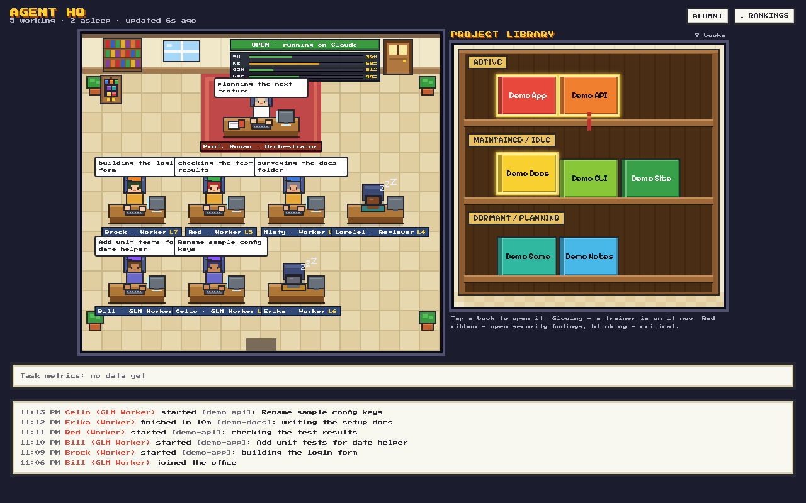
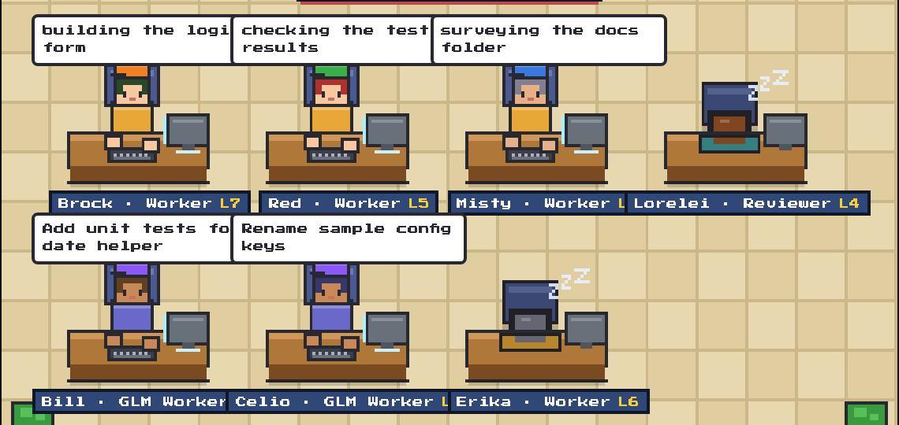
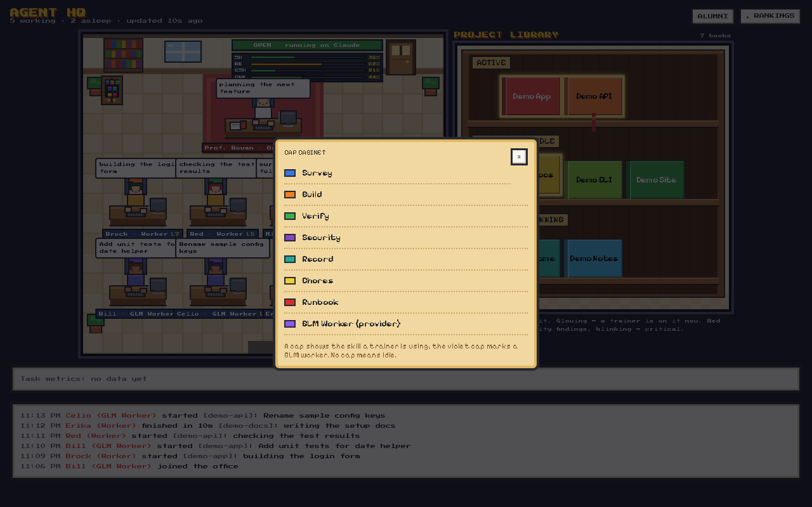
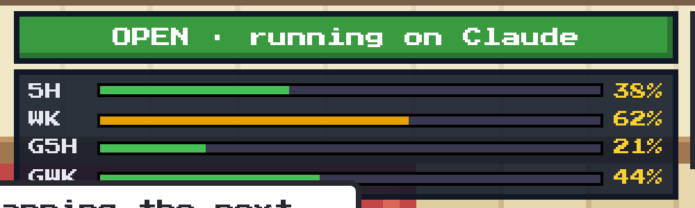
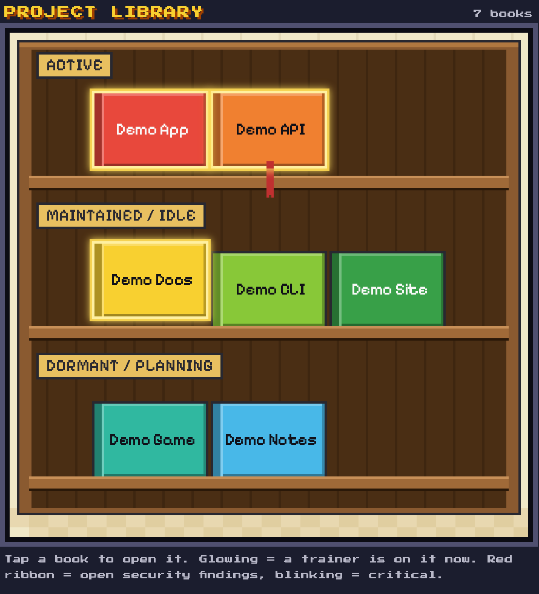
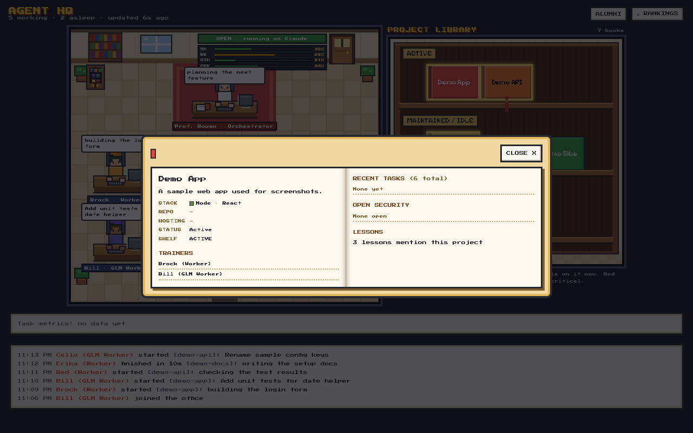
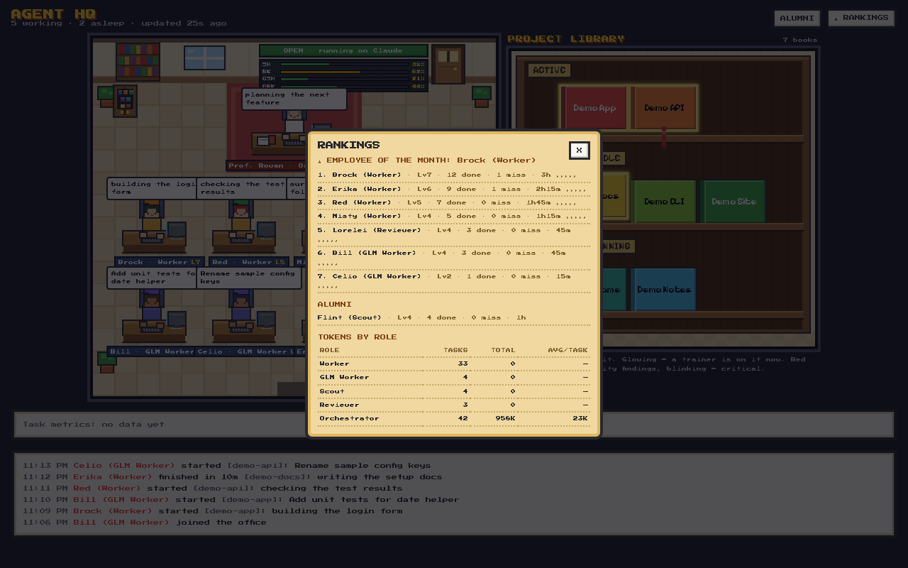
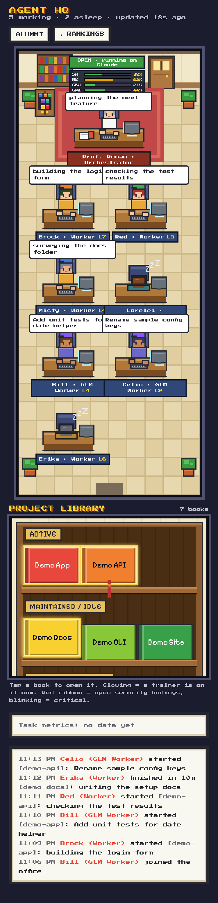
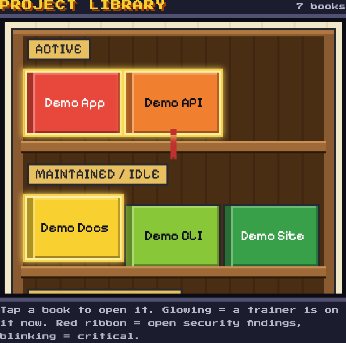

# The pixel office — a tour

The office is one HTML page (`office/site/index.html` + `library.js`) drawn entirely on
HTML canvas in a pixel-art style, with DOM overlays for text. Everything below is
described from **sample data** (`office/state.sample.json` and a sample `projects.json`),
so no real names or tasks appear. The screenshots were taken from that sample data (made-up projects such as
"demo-app").

## The scene

Prof. Rowan's desk sits in the middle at the top: papers, a red mug, a monitor whose
glow spills onto the desk while the office is thinking. Below and beside it are the
trainer desks — one slot per active Worker or Reviewer, four per row on desktop. Each
trainer gets a name from the pools in `office/names.json` (Pokémon gym leaders and
champions — Brock, Red, Misty, Lorelei…); when every desk of a type is busy the office
hires the next name from that pool, and a second Brock becomes "Brock II". Under the
name tag, `L7` is the trainer's level. A cap cabinet by the door displays the seven
skill caps; plants, a rug, windows and a doormat fill out the room.

## Trainer states

- **Working** — sitting up, hands on the keyboard, a key flashing every few frames; a
  speech bubble over the desk shows the current task (clipped to ~38 chars).
- **Sleeping** — head down, breathing bob, and three staggered "z z Z" glyphs drifting
  up.
- **Idle / thinking** — the `Zz` marker without the drift.
Clicking a desk opens that trainer's card: role, ID, hire date, rating stars, task
count, desk time, misses, token totals, and the last five tasks with durations. The
boss's card counts requests instead of tasks.

## Skill caps

While a Worker uses a skill it wears a cap: **survey** blue, **build** orange, **verify**
green, **security** purple, **record** teal, **chores** yellow, **runbook** red. No cap
means idle. The cap cabinet (click it) shows the legend; the public view shows caps but
never task text.

## The OPEN/CLOSED sign

The plate reads OPEN · running on Claude/GLM, or CLOSED with the reopen time parsed from
the limit message. Under it, usage bars: the Claude **5-hour** and **weekly** window
percentages (green → amber at 50% → red at 80%), and, when a GLM key is configured, the
**G5H** and **GWK** plan-quota bars. A window the provider doesn't report shows `n/a`,
never 0; tooltips carry reset times and per-model tokens.

## The project library

On wide screens the library is a second room beside the office; below 1100px it stacks
underneath. Projects are books on shelves by status — ACTIVE, MAINTAINED / IDLE,
DORMANT / PLANNING — each book's colour picked from a fixed 16-colour palette. A book
**glows** while a trainer is working on that project; a red ribbon marks open security
findings (blinking when critical). Click a book for its spread: description, stack
swatch, repo/hosting, trainers, recent tasks, open security, lesson count. In the public
view the spread shows only the title and shelf.

## GLM Worker desks

If you run work on GLM (see the optional GLM section in [SETUP.md](SETUP.md)), each
`bin/glm-run` session gets its own desk, shown with a **violet cap** and the role
"GLM Worker". **Bill** is the permanent GLM desk and sleeps between runs. When runs
overlap, the next names from the `glm` pool in `names.json` take temporary desks, in order:
**Celio, Lanette, Bebe, Amanita**. A temporary desk disappears when its run ends; its work
stays in the feed. The desk shows the brief's title, and the matching project book glows.
A GLM run never changes the OPEN/CLOSED sign or hires Claude trainers. In the screenshots
above, Bill and Celio are both at work.

## Alumni and Rankings

**★ RANKINGS** ranks active trainers by tasks minus twice their misses, crowns an
employee of the month, and sums tokens by role. **ALUMNI** lists retired trainer types
with their stats intact. Both are owner-view only.

## Owner view vs public view

Signed out (or not the owner) the page reads only the public subset: the scene with
names, roles, levels and caps, the OPEN/CLOSED plate, and book titles. Hidden: task
text, the activity feed, rankings, alumni, usage bars, task metrics. The office feed at
the bottom (owner view) is a live log — hires, starts, finishes, misses, token counts.

## Phone layout and reduced motion

The library on a phone, stacked under the office:

Below 700px the office goes two desks per row, tags wrap to two lines, and the sign
shrinks; the library scrolls in its own box. With **reduced motion** enabled the z's,
key flashes, glows and ribbons freeze to static frames.

## Where the data comes from

- **Local** (`serve.mjs`, default): the page polls `state.json`, `events.jsonl`,
  `projects.json`, `library.json`, `limits.json`, `glm.json` and `tasks.json` every 3 s.
- **Hosted (Firebase)**: Google sign-in; the owner subscribes to the RTDB `/office` node
  (full state, events, side files), everyone else to `/public` — a whitelisted subset
  written by the same pusher. The page picks its source from the hostname; `?source=`
  overrides.

## Screenshots

All shots are from sample data at 1280px (desktop) or 375px (phone), in `docs/screenshots/`:
`office-1280`, `office-375`, `trainer-states`, `skill-caps`, `sign-bars`, `library-1280`,
`library-375`, `book-spread`, `rankings`. There is no public-view shot: the local
`serve.mjs` does not serve the public fixture (`?view=public` needs a separate
`public.json` server), so the public view appears only when hosted on Firebase.
